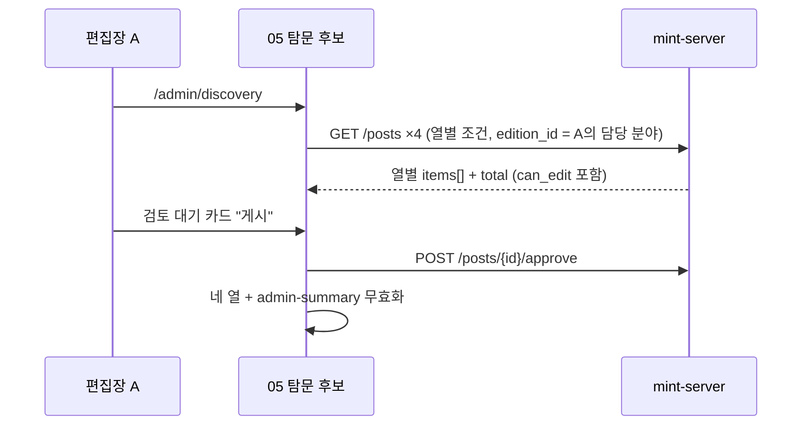
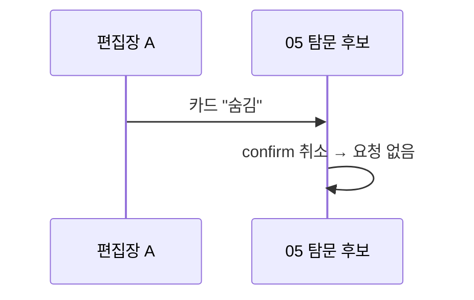

<!-- AI 지시문: 기능요청서 + 인터페이스 정의를 입력으로 작성하라. 3페이지 상한. 구현 코드를 쓰지 말고 구현이 따라갈 결정만 써라. 이 문서가 바이브코딩의 입력이다. -->
# 기술스펙_탐문후보보드

- 기능요청: [mint-web#105](https://github.com/MEV-SW/mint-web/issues/105) — 관리자 리뉴얼 2차 FE-E
- 인터페이스 정의: 화면은 Figma R5 R5-3 탐문 후보 보드·R5-13과 핸드오프 `MINT/.agents/design/admin-renewal-r5-handoff.md` §2·§3 "05"가 겸함. API는 [mint-server API스펙_기사목록필터](https://github.com/MEV-SW/mint-server/blob/main/docs/기능/177-기사목록필터/API스펙_기사목록필터.md)(#177, `edition_id`·`created_by`), 기사 액션·`can_edit`([#170](https://github.com/MEV-SW/mint-server/blob/main/docs/기능/170-기사편집권한분야제한/API스펙_기사편집권한분야제한.md)), 관리 요약(#174) `pending_candidates`, 수집 설정 조회(`GET /sources/collection-settings`).
- 선행: mint-server#177 배포(이 카드는 백엔드 다음에 배포)
- 작성: 채윤성 (`yschae0311`) / 승인: 리뷰 없음 (MEV 기술스펙 규칙)

## 변경 범위
- `src/pages/AdminDiscoveryPage.tsx` (신규), 라우트 `/admin/discovery`를 `AdminRoute`(총관 또는 아무 분야 편집장) 안에 둔다. 사이드바 05 "탐문 후보"(콘텐츠 그룹, `adminOnly` = 총관·편집장, 뱃지 = 관리 요약 `pending_candidates`, amber).
- 보드 열 4개와 조회 조건(`GET /posts`, 열마다 한 번):

| 열 | 조건 |
|---|---|
| 검토 대기 | `created_by=ai_discovery&board_type=discovery&status=pending` |
| 게시됨 | `created_by=ai_discovery&board_type=discovery&status=published` |
| 승격됨 | `created_by=ai_discovery&board_type=trusted&status=published` |
| 숨김 | `created_by=ai_discovery&status=hidden` (게시판 구분 없음) |

- 모든 열에 `created_by=ai_discovery`를 건다(탐문으로 들어온 기사는 저장 시 항상 이 값). 숨김은 `board_type`을 바꾸지 않으므로(`hide`는 상태만 바꿈) 숨김 열은 게시판 조건 없이 조회한다 — 승격된 뒤 숨긴 기사도 숨김 열에 나온다. 숨김에서 "게시"(approve)하면 게시판은 그대로이고 상태만 published가 되어, 원래 게시판에 따라 게시됨 또는 승격됨 열로 돌아간다.

- 분야 범위: 화면 위 분야 칩. 총관은 "전체" + 조직의 활성 분야, 편집장은 본인이 편집장인 분야만(`usePermissions`의 편집 분야). "전체"는 총관이면 `edition_id`를 넣지 않고, 편집장이면 담당 분야 전부를 `edition_id`로 넣는다 — 편집장은 다른 분야 후보를 이 화면에서 보지 않는다(핸드오프 결정). 칩 하나를 고르면 그 분야만.
- 열마다 처음 20건, "더 보기"로 20건씩 늘린다(`size` 최대 100까지, 넘으면 "뉴스 화면에서 더 보기" 안내). 열 머리에 건수(`total`).
- 카드: 제목(기사 상세 링크), 출처, 수집 시각, AI 요약 한두 줄. 동작 버튼은 `can_edit === true`일 때만: 검토 대기 → 게시(approve)·승격(promote)·숨김(hide), 게시됨 → 승격·숨김, 승격됨 → 숨김, 숨김 → 게시. 숨김은 `useConfirm`으로 확인(되돌릴 수 있지만 목록에서 사라지므로), 게시·승격은 바로 실행. 실행 후 네 열과 `['admin-summary']`를 무효화한다. 끌어서 옮기기는 범위 밖(핸드오프).
- 보관 기한 표시: 화면 위 한 줄 "검토 대기 {N}일 경과 시 자동 삭제 (운영 설정값, 기본 14)". `N`은 수집 설정 조회. 설정 변경은 02 작업 로그(총관)로 링크.
- 기존 경로: 지금의 `/discovery`(뉴스 화면 리다이렉트)는 그대로 둔다. 관리 홈(#96)의 "탐문 후보" 카드 링크를 `/admin/discovery`로 바꾼다.
- 공통 상태(R5-13): 열마다 로딩 스켈레톤·빈 문구("이 상태의 후보가 없습니다")·오류 배너(다시 시도). 375px에서는 열을 위아래로 쌓고 열 제목을 접을 수 있게 한다.

## DB 스키마 변경분
- 없음 (프론트엔드).

## 핵심 흐름 (시퀀스 1-2개)

## 외부 의존성
- mint-server#177. 프론트가 먼저 배포되면 `created_by`·`edition_id`가 무시돼 승격됨 열에 중요 게시판 전체가 섞이고 분야 칩이 동작하지 않는다. 그래서 백엔드 먼저 배포한다.

## flag
- 없음.

## 테스트
- `npm run build`·변경 파일 `eslint`.
- 브라우저(검증 페이지 또는 응답 고정): 승격 → 숨김 → 게시 흐름에서 카드가 승격됨 → 숨김 → 승격됨 열로 옮겨짐, 열 4개 배치, 375px 쌓임, `can_edit=false` 카드에 버튼 없음, 숨김 확인 취소 시 요청 없음, 편집장 분야 칩이 담당 분야만 보임, 네트워크 요청의 `edition_id`·`created_by` 값 확인.
