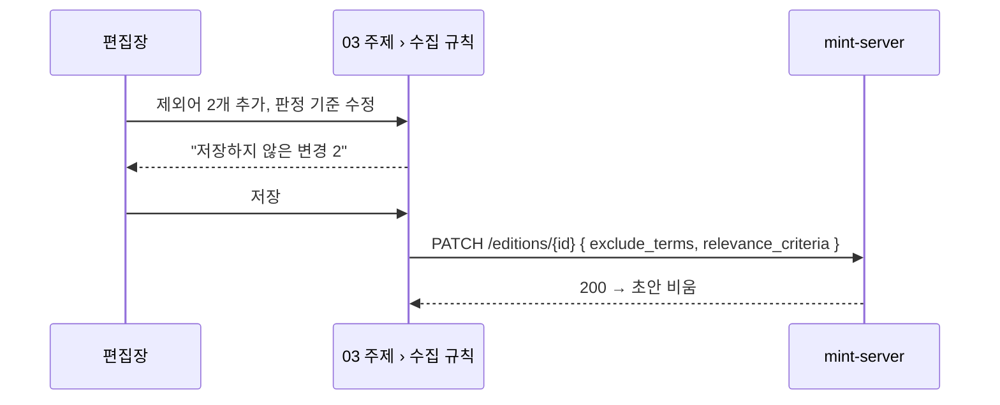
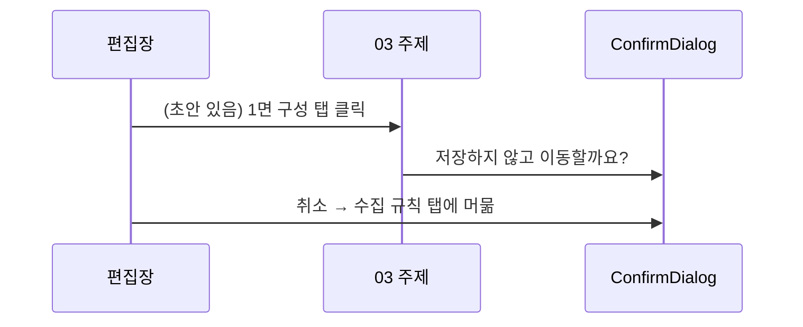

<!-- AI 지시문: 기능요청서 + 인터페이스 정의를 입력으로 작성하라. 3페이지 상한. 구현 코드를 쓰지 말고 구현이 따라갈 결정만 써라. 이 문서가 바이브코딩의 입력이다. -->
# 기술스펙_주제하위탭

- 기능요청: [mint-web#106](https://github.com/MEV-SW/mint-web/issues/106) — 관리자 리뉴얼 2차 FE-F
- 인터페이스 정의: 화면은 Figma R5 R5-2 주제 › 수집 규칙·R5-13과 핸드오프 §3 "03 주제"가 겸함. API는 기존 그대로(`PATCH /editions/{id}`, `PUT /editions/{id}/keywords/featured`, `POST /keywords`, `PUT /categories/featured`, 소스 목록).
- 작성: 채윤성 (`yschae0311`) / 승인: 리뷰 없음 (MEV 기술스펙 규칙)

## 현재 상태
- `SettingsPage.tsx`(약 900줄)의 주제 상세가 한 화면에 6개 구역(표시 방식·관련성 키워드·판정 기준·제목 제외어·소스 배정·지면 메인 키워드)으로 이어지고, 칩 추가·삭제와 표시 방식 변경은 누르는 즉시 저장된다. 페이지 아래에 총관용 "소스 정책 확인"·"뉴스 탭 강조 분야" 구역이 더 있다.

## 변경 범위
- 왼쪽 주제 목록과 주제 머리(이름·활성 토글)는 그대로. 주제 상세를 하위 탭 4개로 나눈다(`role="tablist"`):

| 탭 | 내용 | 저장 |
|---|---|---|
| 기본·표시 | 표시 방식(뉴스형/트렌드형) | 탭 아래 "저장" — `PATCH /editions/{id}` `display_mode` |
| 수집 규칙 | 관련성 키워드(`topic_terms`), 판정 기준(`relevance_criteria`), 제목 제외어(`exclude_terms`) | 탭 아래 "저장" — 바뀐 필드만 한 번의 `PATCH` |
| 소스 | 이 주제에 배정된 소스 목록 + 검색, **읽기 전용** | 없음. "배정 변경은 04 소스에서" 링크(`/admin/sources?edition={id}`) |
| 1면 구성 | 지면 메인 키워드 선택 + 키워드 추가. 총관에게만 아래에 "뉴스 탭 강조 분야"(조직 전체 설정) 블록 | 탭 아래 "저장" — 메인 키워드(`PUT …/keywords/featured`)와 강조 분야(`PUT /categories/featured`) 중 바뀐 것만 |

- 저장 방식 변경: 기본·표시와 수집 규칙의 즉시 저장을 **탭별 초안**으로 바꾼다. 칩 추가·삭제·표시 방식 선택은 초안만 바꾸고, 탭 아래에 "저장하지 않은 변경 N"(바뀐 필드 수)과 "저장"·"되돌리기"를 둔다. 키워드 "추가"는 키워드 항목을 새로 만드는 동작이라 지금처럼 바로 실행한다(1면 구성의 메인 키워드 선택만 초안).
- 떠날 때 확인: 초안이 있는 상태에서 다른 탭·다른 주제를 누르면 `useConfirm`("저장하지 않은 변경 N개가 있습니다. 저장하지 않고 이동할까요?"). 페이지 닫기·새로고침은 `beforeunload`로 막는다. **사이드바 등 다른 화면으로의 이동은 막지 못한다** — 앱이 데이터 라우터가 아닌 `BrowserRouter`라 `useBlocker`를 쓸 수 없다. 대신 저장하지 않은 변경이 있으면 사이드바 03 항목 옆에 점 표시를 한다.
- 탭 상태는 `?tab=basic|rules|sources|front` 쿼리로 남겨 새로고침·공유에도 유지한다. 기존 `#editions` 해시 링크는 기본·표시 탭으로 연다.
- 소스 탭이 읽기 전용이 되면서 지금 있는 "소스 주제 이동" 선택 상자(확인 창 포함)를 지운다. 같은 일을 04 소스 편집 창(`SourceFormFields`의 "소속 주제", 같은 `PATCH /sources/{id}`)에서 할 수 있다.
- "소스 정책 확인" 구역은 이 카드에서 건드리지 않는다(04로 옮기는 것은 #107).
- 비편집자(일반 사용자)용 "내 지면" 화면(`MyEditionsSection`)은 그대로.

## DB 스키마 변경분
- 없음 (프론트엔드).

## 핵심 흐름 (시퀀스 1-2개)

## 외부 의존성
- 없음.

## flag
- 없음.

## 테스트
- `npm run build`·변경 파일 `eslint`.
- 브라우저(응답 고정): 탭 전환, 초안 수·되돌리기, 저장 요청 본문에 바뀐 필드만, 탭/주제 이동 확인 취소 시 머묾, `?tab=` 새로고침 유지, `#editions` → 기본·표시, 소스 탭에 이동 선택 상자 없음, 375px 탭 가로 스크롤.
