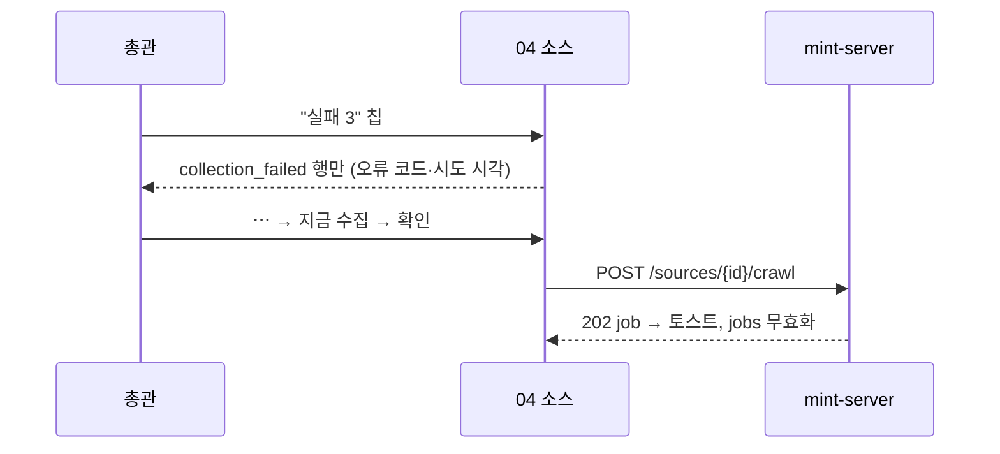
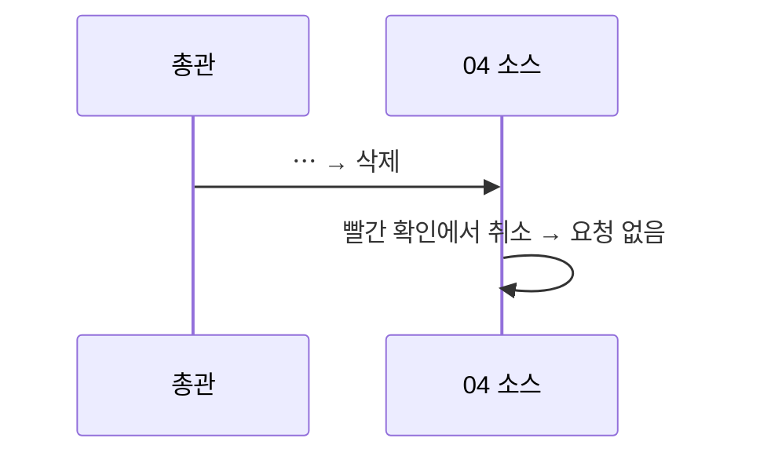

<!-- AI 지시문: 기능요청서 + 인터페이스 정의를 입력으로 작성하라. 3페이지 상한. 구현 코드를 쓰지 말고 구현이 따라갈 결정만 써라. 이 문서가 바이브코딩의 입력이다. -->
# 기술스펙_소스표정리

- 기능요청: [mint-web#107](https://github.com/MEV-SW/mint-web/issues/107) — 관리자 리뉴얼 2차 FE-G
- 인터페이스 정의: 화면은 Figma R5 R5-8 소스(2026-10-20 수정본)·R5-13과 핸드오프 §3 "04 소스"가 겸함. API는 [mint-server API스펙_소스수집상태](https://github.com/MEV-SW/mint-server/blob/main/docs/기능/178-소스수집상태/API스펙_소스수집상태.md)(#178, `collection_failed`·`last_error_code`·`last_attempted_at`)와 기존 소스 API.
- 선행: mint-server#178 배포. #106(03 소스 탭 읽기 전용 → 배정 변경은 여기서만)
- 작성: 채윤성 (`yschae0311`) / 승인: 리뷰 없음 (MEV 기술스펙 규칙)

## 변경 범위
- `src/pages/SourcesPage.tsx` 목록 영역(수집 실행 카드는 #94에서 이미 02 작업 로그로 옮김):
  - 필터 칩: 전체 / 실패 / 꺼짐 / 자동 게시 꺼짐 — 칩마다 건수(클라이언트 계산). 실패 = `is_active && collection_failed`, 꺼짐 = `!is_active`, 자동 게시 꺼짐 = `!auto_publish`(2026-10-20 결정: "검토"는 자동 게시 열에서만 쓰는 말).
  - 주제 선택(기존 `editionFilter`)과 검색은 유지. `?edition={id}` 쿼리(03 소스 탭 링크)로 들어오면 주제 선택을 미리 맞춘다.
  - 지금의 공식/커뮤니티 탭은 칩과 겹치지 않도록 주제 선택 옆 "종류" 선택(전체/공식/커뮤니티)으로 옮긴다(기능 유지).
  - 열: 소스(이름·URL) · 유형 · 주제 · 자동 게시(자동/검토) · 상태 · 마지막 수집 · ⋯. 카테고리·신뢰도 열은 편집 창에서만 보이게 빼고, 활성 토글 열과 관리 버튼 열은 지운다.
  - 상태 열: 꺼짐(회색, `!is_active`) > 실패(빨강, `collection_failed`) > 정상 순으로 하나만. 실패에는 `last_error_code`와 `last_attempted_at`을 툴팁·작은 글씨로 보인다.
  - 행 ⋯ 메뉴(기존 `OverflowMenu`): 편집 · 지금 수집 · 탐문으로 수집 · 끄기/켜기 · 삭제. **모두 `useConfirm`을 거친다**(카드 요구). 지금 수집·탐문으로 수집은 진행 중 작업이 있으면 비활성(지금 규칙 유지), 끄기·삭제는 빨간 확인, 켜기는 일반 확인. Reddit은 켜기를 막는 지금 규칙을 그대로 둔다(메뉴 항목 비활성 + 안내).
  - 실행 결과 처리(토스트, `['jobs']`·`['sources']` 무효화)는 지금과 같다. 끄기/켜기·삭제 뒤에는 `['admin-summary']`도 무효화한다.
- "소스 정책 확인" 구역(총관 전용, 지금 03 주제 아래)을 이 화면 맨 아래로 옮긴다. 내용은 그대로이고 접힌 상태로 시작한다. `SettingsPage.tsx`에서는 지운다.
- 375px: 표를 카드 목록으로 바꾼다(소스명·상태·자동 게시·⋯, 나머지는 작은 글씨).

## DB 스키마 변경분
- 없음 (프론트엔드).

## 핵심 흐름 (시퀀스 1-2개)

## 외부 의존성
- mint-server#178. 프론트가 먼저 배포되면 `collection_failed`가 없어 실패 칩이 0이고 모든 활성 소스가 정상으로 보인다(다른 기능 영향 없음). 백엔드 먼저 배포한다.

## flag
- 없음.

## 테스트
- `npm run build`·변경 파일 `eslint`.
- 브라우저(응답 고정): 칩 건수·필터, `?edition=` 미리 선택, 종류 선택 유지, 상태 우선순위(꺼짐 > 실패 > 정상), ⋯ 각 항목 확인 창과 취소 시 요청 없음, Reddit 켜기 비활성, 소스 정책 확인 구역이 03에서 사라지고 04 아래에 있음, 375px 카드 목록.
