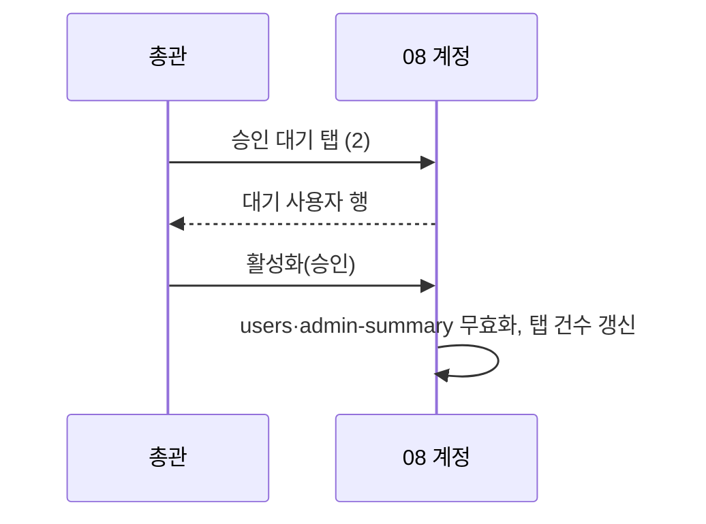
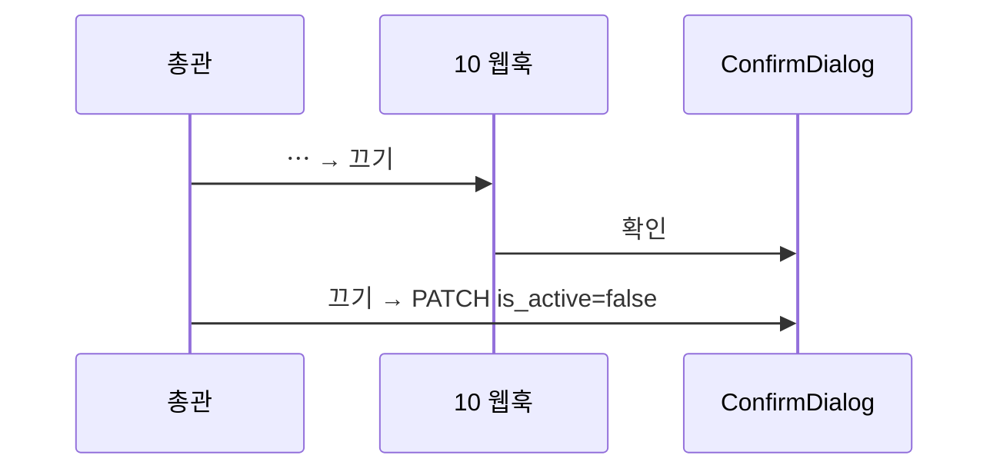

<!-- AI 지시문: 기능요청서 + 인터페이스 정의를 입력으로 작성하라. 3페이지 상한. 구현 코드를 쓰지 말고 구현이 따라갈 결정만 써라. 이 문서가 바이브코딩의 입력이다. -->
# 기술스펙_계정문의웹훅정리

- 기능요청: [mint-web#108](https://github.com/MEV-SW/mint-web/issues/108) — 관리자 리뉴얼 2차 FE-H (08 계정 · 09 문의 · 10 웹훅). 화면당 변경이 작아 카드를 나누지 않는 안으로 진행한다(2026-10-20 PM에 제안, 이견 없음 — 나눠야 하면 구현 전 조정).
- 인터페이스 정의: 화면은 Figma R5 R5-4(역할·권한)·R5-11(문의)·R5-12(웹훅)·R5-13과 핸드오프 §3·§6(웹훅 1차 폴백)이 겸함. API는 기존 그대로(사용자·문의·웹훅).
- 작성: 채윤성 (`yschae0311`) / 승인: 리뷰 없음 (MEV 기술스펙 규칙)

## 변경 범위

### 08 계정 (`AdminAccountsPage.tsx`)
- 하위 탭 3개: 구성원 / 승인 대기 / 역할·권한. 탭 상태는 `?tab=members|pending|roles`.
- 구성원: 지금 표와 필터(전체·미배정·총관·비활성)를 그대로 쓴다. "승인 대기" 필터는 탭으로 옮겨 필터에서 뺀다.
- 승인 대기: `approval_status === 'pending'` 사용자만, 같은 행 동작(활성화로 승인 등). 탭 이름 옆 건수(사이드바 08 뱃지와 같은 값).
- 역할·권한: 읽기 전용 매트릭스. 아래 표를 코드 상수 하나(`src/constants/permissionMatrix.ts`)로 두고 그린다. 각 행에 근거 API를 주석으로 남겨, 권한이 바뀌면 같이 고치게 한다. 한 사람이 여러 역할이면 권한은 합집합이라는 안내를 표 위에 둔다.

| 기능 | 총관 | 매니저 | 분야 편집장 | 일반(멤버·뷰어) |
|---|---|---|---|---|
| 관리 홈·작업 로그·이슈 병합·계정·문의 답변·웹훅 | ● | – | – | – |
| 전체 수집·파이프라인 실행·탐문 후보 삭제 기한 | ● | – | – | – |
| 주제 설정 편집 | ● 전체 | – | ● 담당 주제 | – (내 지면 선택만) |
| 소스 등록·수정·삭제·소스별 수집 | ● 전체 | – | ● 담당 분야 소스만 | – |
| 카테고리 목록 보기(뉴스 분류 등 화면에서 쓰는 조회 API) | ● | ● | ● | ● |
| 06 카테고리 화면 보기·AI 소스 제안·승인 | ● | ● | – | – |
| 카테고리 만들기·수정·비활성화 | ● | – | – | – |
| 기사 검토(게시·숨김·삭제·승격·요약) | ● | – | ● 기사가 연결된 분야 | – |
| 탐문 후보 보드 | ● 전체 | – | ● 담당 분야 | – |
| 리포트 생성 | ● | – | ● 담당 분야 | – |
| 리포트 삭제·슬랙 발송 | ● | – | – | – |
| 키워드 추가 | ● | – | ● | – |
| 키워드 승격·수정·병합 | ● | – | – | – |
| 문의 작성 | – | ● | ● | ● |

  근거: `MINT_Backend/app/api/v1/*.py`의 `require_admin`·`require_edition_editor_any`·`require_edition_editor`·`require_post_editor`(#170)·`require_source_reviewer`·`require_inquiry_submitter`와 프론트 `visibleAdminNav`(2026-10-20 기준).

### 09 문의 (`AdminInquiriesPage.tsx`)
- 기본 필터를 "전체"에서 "미답변"(`open`)으로 바꾼다.
- 목록 정렬: 미답변을 위로, 그 안에서는 오래된 순(먼저 받은 문의부터). 나머지(답변됨·종료)는 최신 순. 정렬은 클라이언트에서 한다(API는 지금 그대로).
- 각 항목에 경과일 "N일 경과"(받은 시각 기준, 오늘이면 "오늘"). 3일 이상 미답변이면 amber.
- 답변·종료는 오른쪽 상세에 그대로(종료 확인 창은 #93에서 추가됨).

### 10 웹훅 (`SlackSettingsPage.tsx`)
- 등록 창: 용도 선택을 `select`에서 세그먼트 버튼(전체/일일/…, 기존 `PURPOSE_LABEL` 순서)으로 바꾼다. 나머지 입력과 검증은 그대로.
- 행: 채널명 · 용도 · URL 표시 · 상태(활성/꺼짐) · ⋯. URL은 응답에 없으므로(보안상 저장만 하고 돌려주지 않음) "저장된 URL (가려짐)"으로만 보인다.
- 행 ⋯: 끄기/켜기(`updateWebhook(id, { is_active })`, 끌 때 확인) · 삭제(빨간 확인, #93 문구). 행마다 테스트는 없다 — 테스트 API가 조직 전체 대상(`POST /slack/test`)이라 화면 위 "테스트 메시지 보내기" 버튼을 그대로 둔다(핸드오프 §6 폴백). "마지막 발송 결과"는 범위 밖(보류 결정).

## DB 스키마 변경분
- 없음 (프론트엔드).

## 핵심 흐름 (시퀀스 1-2개)

## 외부 의존성
- 없음.

## flag
- 없음.

## 테스트
- `npm run build`·변경 파일 `eslint`.
- 브라우저(응답 고정): 08 탭 전환·`?tab=` 유지·승인 대기 건수, 매트릭스 표가 상수와 같음, 09 기본 미답변·정렬·경과일·3일 이상 amber, 10 세그먼트 선택·URL 가림 문구·⋯ 끄기 확인 취소 시 요청 없음, 375px 레이아웃.
