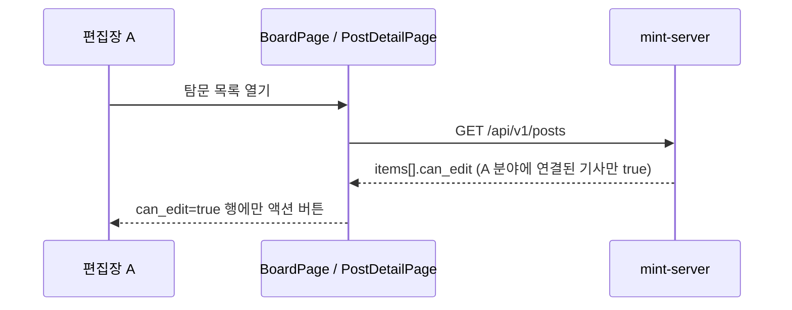
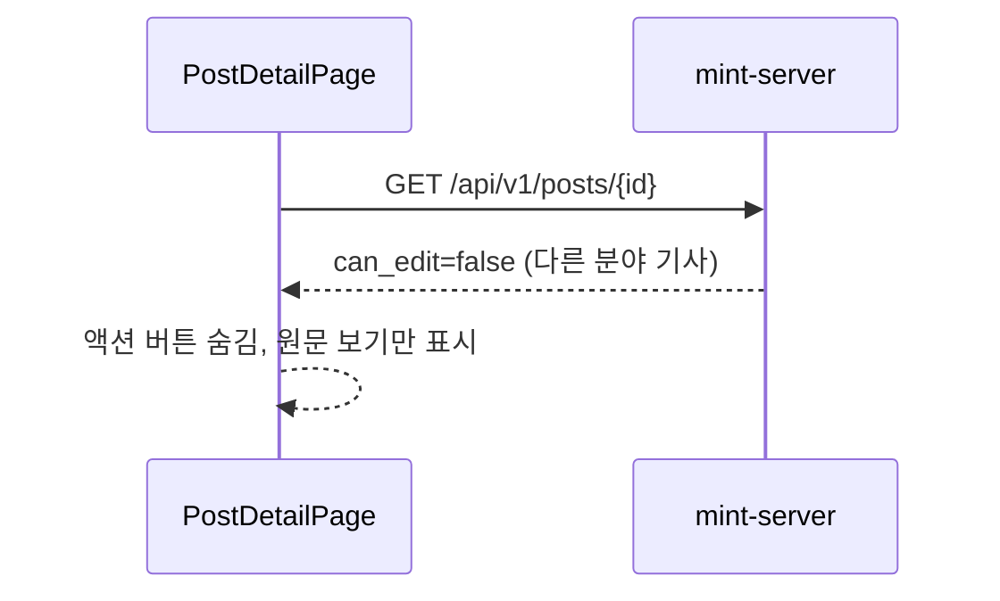

<!-- AI 지시문: 기능요청서 + 인터페이스 정의를 입력으로 작성하라. 3페이지 상한. 구현 코드를 쓰지 말고 구현이 따라갈 결정만 써라. 이 문서가 바이브코딩의 입력이다. -->
# 기술스펙_기사편집권한분야제한

- 기능요청: [mint-web#91](https://github.com/MEV-SW/mint-web/issues/91) (세트: [mint-server#170](https://github.com/MEV-SW/mint-server/issues/170), 같은 릴리즈)
- 인터페이스 정의: 백엔드 [API스펙_기사편집권한분야제한](https://github.com/MEV-SW/mint-server/blob/main/docs/기능/170-기사편집권한분야제한/API스펙_기사편집권한분야제한.md)이 겸함 — `PostRead.can_edit`
- 작성: 채윤성 (`yschae0311`) / 승인: 리뷰 없음 (MEV 기술스펙 규칙)

## 변경 범위
- `src/types/post.ts`: `Post`에 `can_edit?: boolean` 추가. 백엔드가 먼저 배포되지 않은 환경에서 필드가 없을 수 있어 선택 필드로 두고, 없으면 `false`로 본다.
- `src/pages/PostDetailPage.tsx`: 기사 액션(요약 다시 생성, 검토 완료, 중요 게시판 승격, 숨김, 삭제)과 분할 화면의 요약 버튼 노출 조건을 전역 `canWrite`에서 `post.can_edit === true`로 바꾼다. "원문 보기"는 지금처럼 누구에게나 보인다.
- `src/pages/BoardPage.tsx`:
  - 액션 열 머리글은 지금처럼 전역 `canWrite`(관리자 또는 아무 분야 편집장)일 때 보여 표 모양을 유지한다.
  - 각 행의 액션 버튼은 `p.can_edit === true`일 때만 그린다. 아니면 같은 칸을 비워 둔다(열 수 유지).
- 바뀌지 않는 것: `usePermissions`의 `canWrite`(소스·주제 관리 등 다른 화면에서 계속 사용), 라우트, API 호출 함수.

## DB 스키마 변경분
- 없음 (프론트엔드).

## 핵심 흐름 (시퀀스 1-2개)

## 외부 의존성
- mint-server#170 배포(`PostRead.can_edit`). 프론트가 먼저 배포되면 `can_edit`이 없어 모든 사용자의 기사 액션 버튼이 숨겨진다(관리자 포함). 그래서 **백엔드 → 프론트 순서로, 같은 릴리즈에서** 배포한다.

## flag
- 프론트 flag 없음. 백엔드 `POST_EDIT_EDITION_SCOPE_ENABLED=false`면 서버가 #165 규칙으로 `can_edit`을 계산하므로 프론트는 그대로 따라간다.

## 테스트
- 프론트엔드에는 테스트 러너가 없다. `npm run build`·변경 파일 `eslint`와, 개발 서버에서 API 응답을 가짜로 바꿔(`can_edit` true/false 섞인 목록·상세) 버튼 노출을 브라우저로 확인한다.
