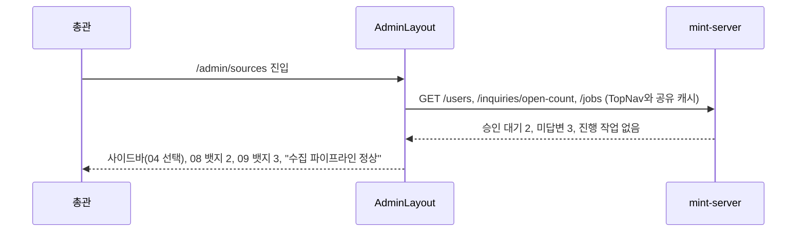
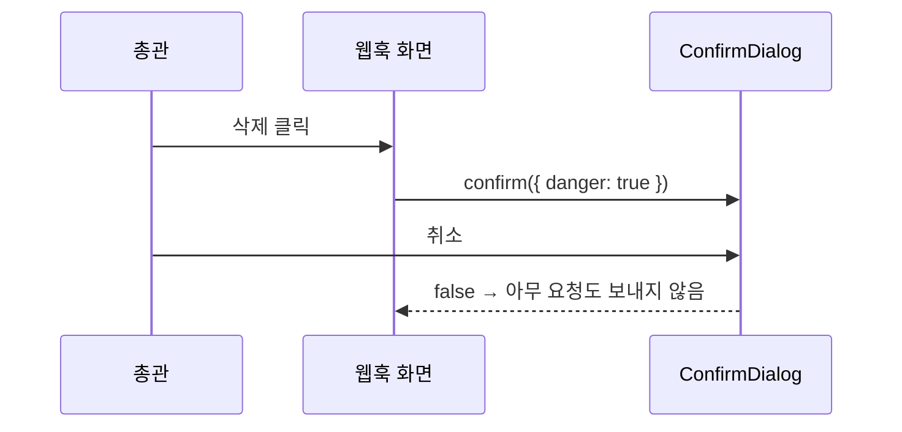

<!-- AI 지시문: 기능요청서 + 인터페이스 정의를 입력으로 작성하라. 3페이지 상한. 구현 코드를 쓰지 말고 구현이 따라갈 결정만 써라. 이 문서가 바이브코딩의 입력이다. -->
# 기술스펙_관리사이드바

- 기능요청: [mint-web#93](https://github.com/MEV-SW/mint-web/issues/93) — 관리자 리뉴얼 1차 FE-A
- 인터페이스 정의(화면): Figma R5 페이지 "R5 · 전역 메뉴 고정 + 관리 좌측 사이드바 (확정)" R5-1·R5-5/6·R5-13과 핸드오프 문서 `MINT/.agents/design/admin-renewal-r5-handoff.md` §1·§2·§4가 겸함. 뱃지 숫자 API는 [mint-server API스펙_관리요약집계](https://github.com/MEV-SW/mint-server/blob/main/docs/기능/174-관리요약집계/API스펙_관리요약집계.md).
- 작성: 채윤성 (`yschae0311`) / 승인: 리뷰 없음 (MEV 기술스펙 규칙)
- 단계 구분(PM 결정 2026-10-19): 1차 = 사이드바(#93), 관리 요약 API(mint-server#174), 02 작업 로그(#94), 07 이슈 병합 확인(#95), 01 관리 홈(#96). **05 탐문 후보 보드(`/admin/discovery`)는 2차 카드**다. 핸드오프 §2의 05 노출 규칙(총관 + 담당 분야 편집장)은 그 2차 카드에서 mint-server#170·mint-web#91(기사별 `can_edit`) 위에 구현한다. 1차 동안 탐문 후보는 지금의 탐문 게시판(`/discovery` → 뉴스 화면 리다이렉트, 기사별 `can_edit`은 #91로 적용)에서 다룬다.

## 변경 범위
- `src/components/layout/navItems.ts`
  - `NavItem`에 `no`(표시 번호 문자열 "01"~"10"), `group`(`운영`·`콘텐츠`·`사람`·`연동`), `badgeKey`, `badgeTone`(`red`·`amber`·`gray`)을 추가한다.
  - 라벨 변경: "이슈 정리" → "이슈 병합", "계정 관리" → "계정", "주제 관리" → "주제".
  - **이 카드에서는 이미 있는 화면(03 주제, 04 소스, 06 카테고리, 07 이슈 병합, 08 계정, 09 문의, 10 웹훅)만 메뉴에 넣는다.** 01 관리 홈(#96), 02 작업 로그(#94), 05 탐문 후보(2차)는 각 카드가 화면과 함께 항목을 추가한다. 빈 화면으로 가는 메뉴가 생기지 않게 하기 위해서다.
  - 노출 규칙은 지금 `visibleAdminNav`를 유지한다(주제=모두, 소스=총관·편집장, 카테고리=총관·매니저, 나머지=총관). 신규 항목 규칙(01·02 총관, 05 총관+편집장)은 각 카드에서 같은 함수에 추가한다.
- `src/components/layout/AdminLayout.tsx`
  - 데스크톱(768px 이상): 좌측 사이드바 244px + 본문. 사이드바 머리에 "관리"(serif 22)와 파이프라인 상태 줄. 그룹 제목 아래 번호·라벨·뱃지 행. 선택 항목은 `--ink` 배경·`--paper` 글자, hover 6% ink, focus 2px pine 외곽선. 번호는 `aria-hidden`.
  - 모바일(768px 미만): 상단 "관리 · {번호} {현재 메뉴} ▾" 막대. 누르면 같은 그룹 목록을 시트로 연다(바깥 탭·Esc로 닫힘, 항목 선택 시 이동 후 닫힘).
  - 지금의 가로 탭 줄(`.admin-subnav`)과 #82에서 넣은 탭 가로 스크롤 규칙은 사이드바로 대체되므로 지운다.
- 파이프라인 상태 줄: 기존 `useJobsQuery`(총관·편집장에게만 사용, TopNav와 같은 조건)를 쓴다. 진행 중 작업이 있으면 info 색 + `jobProgressSummary`, 최근 작업 중 실패가 있으면 red + "실패 N", 아니면 "수집 파이프라인 정상". 시각 문구는 고정 문구 "매일 06:00·06:30"(탐문 06:00, 커뮤니티 06:30 — 지금 소스 화면 설명과 같은 일정)으로 둔다(PM 결정 2026-10-19). 권한이 없는 사용자에게는 상태 줄을 숨긴다.
- 뱃지:
  - 지금 있는 숫자만 쓴다: 08 계정 = 승인 대기(red), 09 문의 = 미답변(amber). TopNav와 같은 쿼리 키(`['users']`, `['inquiries-open-count']`)를 재사용해 요청이 늘지 않게 한다.
  - 04 소스(실패, red)·05 탐문 후보(amber)는 관리 요약 API(mint-server#174)를 쓰는 #96에서 연결한다. 07 이슈 병합 뱃지는 1차 제외(핸드오프 §6).
  - 0이면 숨김, 99 초과면 "99+". 로딩 중에는 "·".
- `src/components/common/ConfirmDialog.tsx` (신규) + `useConfirm()` 훅: 기존 `Modal` 위에 제목·본문·취소/확인 버튼. 확인 버튼은 오른쪽, 파괴적 동작이면 빨간색(`danger`). 훅은 `confirm({ title, body, confirmLabel, danger }) → Promise<boolean>`을 돌려준다. 앱 최상단(ToastProvider 옆)에 `ConfirmProvider`를 둔다.
- `window.confirm` 교체(관리 영역만): `JobStatusPanel`(취소·삭제·완료 정리), `AdminCategoriesPage`(비활성화), `SourcesPage`(삭제, 일괄 동작), `SettingsPage`(소스 이동 2곳), `SlackSettingsPage`(삭제), `AdminAccountsPage`(총관 지정·해제, 비활성화). 문구는 지금 문구를 그대로 옮긴다. `ReportDetailPage`는 관리 영역이 아니어서 이번 범위가 아니다.
- **지금은 확인 없이 바로 요청하는 동작에도 확인을 추가한다**(핸드오프 §4 대상): `AdminInquiriesPage` "문의 종료"(지금 `close.mutate()` 즉시 호출) → "이 문의를 종료할까요? 종료 후에는 답변할 수 없습니다.", `SourcesPage` 활성 토글을 **끌 때**(지금 `toggleActive.mutate` 즉시 호출) → "‘{소스명}’ 수집을 끌까요? 다시 켤 때까지 수집하지 않습니다." (켤 때는 확인 없이 바로, Reddit 잠금 규칙은 그대로). 두 경우 모두 취소하면 요청을 보내지 않는다.
- 라우트: 이 카드에서는 바꾸지 않는다. `/admin` 인덱스는 지금처럼 `/admin/settings`로 보낸다(#96이 관리 홈으로 바꾼다). 기존 `/admin/settings#editions` 같은 해시 링크는 03 주제 경로가 그대로라 계속 동작한다. 하위 탭 해시 매핑은 2차 주제 카드에서 다룬다.

## DB 스키마 변경분
- 없음 (프론트엔드).

## 핵심 흐름 (시퀀스 1-2개)

## 외부 의존성
- 없음. 뱃지 중 04·05는 mint-server#174가 배포된 뒤 #96에서 연결한다.

## flag
- 없음.

## 테스트
- 프론트엔드에는 테스트 러너가 없다. `npm run build`·변경 파일 `eslint`.
- 브라우저(개발 서버 + 빌드 CSS 검증 페이지): 1280px 사이드바 244px·선택 표시·뱃지 숨김/99+, 375px 막대·시트 열고 닫기, 키보드 Tab·Enter·Esc. 역할별 메뉴 노출은 `visibleAdminNav` 단위 확인.
- `window.confirm`이 관리 영역에 남지 않았는지 검색으로 확인.
