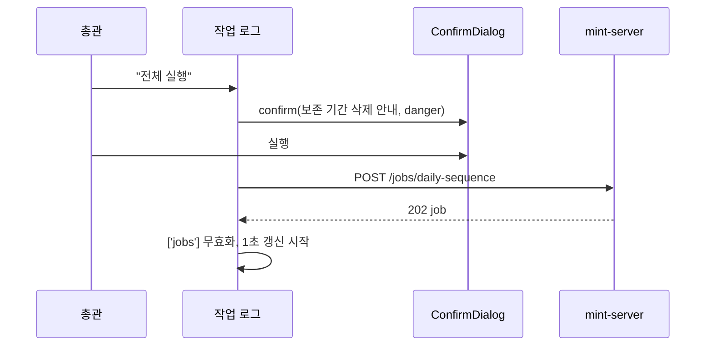
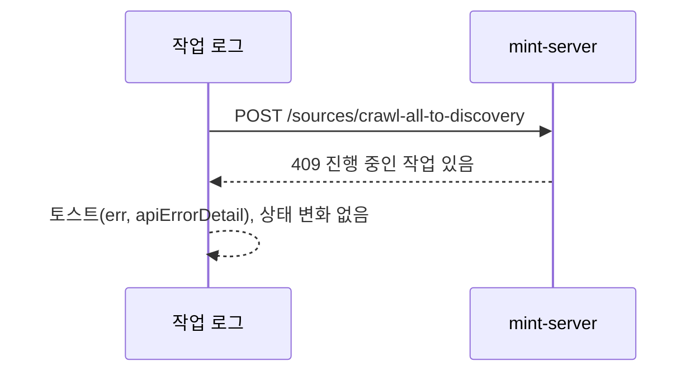

<!-- AI 지시문: 기능요청서 + 인터페이스 정의를 입력으로 작성하라. 3페이지 상한. 구현 코드를 쓰지 말고 구현이 따라갈 결정만 써라. 이 문서가 바이브코딩의 입력이다. -->
# 기술스펙_작업로그화면

- 기능요청: [mint-web#94](https://github.com/MEV-SW/mint-web/issues/94) — 관리자 리뉴얼 1차 FE-B
- 인터페이스 정의(화면): Figma R5 페이지의 R5-7 작업 로그, R5-13 공통 상태와 핸드오프 문서 §3 "02 작업 로그"가 겸함. API는 기존 것만 쓴다(`/jobs`, `/jobs/daily-sequence`, `/sources/crawl-all`, `/sources/crawl-all-to-discovery`, 수집 설정 조회·수정).
- 선행: [#93](https://github.com/MEV-SW/mint-web/issues/93) 사이드바·`useConfirm`
- 작성: 채윤성 (`yschae0311`) / 승인: 리뷰 없음 (MEV 기술스펙 규칙)

## 변경 범위
- `src/pages/AdminJobsPage.tsx` (신규), 라우트 `/admin/jobs`(총관 전용 — `SuperAdminRoute` 안), 사이드바 02 "작업 로그"(운영 그룹, 총관만 노출).
- 화면 구성(R5-7):
  - 위: 파이프라인 카드 4개 — 일일 수집 시퀀스("수집만", "전체 실행"), 탐문 파이프라인("지금 실행"), 커뮤니티 탐문("지금 실행"). 지금 `SourcesPage`의 카드 동작·문구·비활성 조건(#89의 총관 전용 포함)을 그대로 옮긴다.
  - 모든 실행 버튼은 실행 전에 `useConfirm`으로 확인한다. "전체 실행"은 지금 `window.confirm` 문구(정리 단계에서 보존 기간이 지난 후보·만료 기사 삭제, Slack 미전송)를 그대로 쓰고 `danger`로 표시한다.
  - "탐문 후보 보관 기한" 설정: 지금 `SourcesPage`의 입력·검증(0~365 정수)·저장(`updateCollectionSettings`)을 옮긴다.
  - 아래: 최근 작업 표 — 작업명, 상태(`JOB_STATUS_LABEL`), 진행률, 시작·종료 시각, 행 동작. 진행 중이면 "취소", 끝났으면 "삭제", 표 머리에 "완료 정리". 동작과 확인 문구는 `JobStatusPanel`과 같다.
  - 작업 재시도는 없다(백엔드 기능 없음). 실패 작업 행에 "실패한 소스는 소스 화면에서 ⋯ → 지금 수집으로 다시 돌릴 수 있습니다" 안내 문구와 04 소스 링크를 둔다.
- 데이터: 기존 `useJobsQuery`를 쓴다. 이 화면에서는 목록 개수를 늘리기 위해 `listJobs({ limit: 50 })`를 쓰는 별도 쿼리 키(`['jobs', 'log']`)를 두고, 진행 중 작업이 있으면 1초마다, 없으면 갱신하지 않는다(지금 패널과 같은 방식). 실행·취소·삭제 후에는 `['jobs']`로 시작하는 쿼리를 모두 무효화한다.
- `src/pages/SourcesPage.tsx`: 파이프라인 카드와 보관 기한 설정 블록을 지우고, 그 자리에 "수집 실행과 보관 기한은 작업 로그에서 관리합니다" 한 줄과 02 링크를 둔다(총관에게만). 편집장은 잃는 기능이 없다: 실행 버튼은 지금도 총관 전용이고(#89), 보관 기한은 화면상 편집장에게도 입력란이 보이지만 저장 API `PATCH /api/v1/sources/collection-settings`가 `require_admin`이라 편집장이 저장하면 지금도 403이다(MINT_Backend `app/api/v1/sources.py:43-47`). 이동으로 오히려 저장할 수 없는 입력란이 편집장에게 보이던 문제가 없어진다. 조회 API(`GET`)는 로그인 사용자 모두 가능하지만 이 화면에서는 총관만 쓴다. 소스 추가 버튼은 소스 화면에 남긴다.
- `JobStatusPanel`(TopNav 작업 팝오버)은 그대로 둔다. 표 동작 함수(취소·삭제·완료 정리)는 두 곳이 같은 문구·동작을 쓰도록 `src/components/jobs/jobActions.ts`로 뺀다.
- 공통 상태(R5-13): 로딩 5행 스켈레톤(300ms 미만이면 생략), 빈 상태 "아직 실행한 작업이 없습니다." + 지금 실행 안내, 로드 실패 시 화면 안 배너 + 다시 시도, 실행 실패는 기존 토스트(`apiErrorDetail`).

## DB 스키마 변경분
- 없음 (프론트엔드).

## 핵심 흐름 (시퀀스 1-2개)

## 외부 의존성
- 없음. 기존 API만 쓴다.

## flag
- 없음.

## 테스트
- `npm run build`·변경 파일 `eslint`.
- 브라우저(개발 서버, 작업 API 응답 고정): 진행 중·완료·실패 작업이 섞인 목록의 행 동작, 실행 전 확인 창, 취소 시 요청 없음, 보관 기한 검증(-1·366·소수 거절), 375px 표 → 카드 목록.
- 소스 화면에서 카드·보관 기한이 사라지고 링크가 보이는지(총관), 편집장에게는 안내 줄이 없는지.
