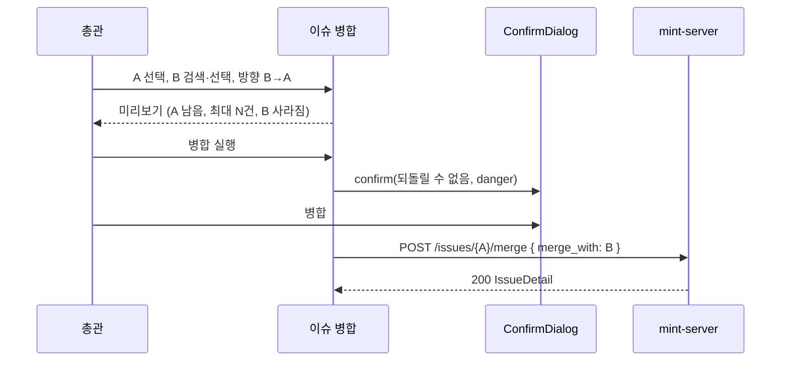
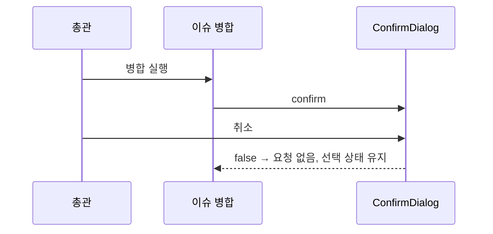

<!-- AI 지시문: 기능요청서 + 인터페이스 정의를 입력으로 작성하라. 3페이지 상한. 구현 코드를 쓰지 말고 구현이 따라갈 결정만 써라. 이 문서가 바이브코딩의 입력이다. -->
# 기술스펙_이슈병합확인

- 기능요청: [mint-web#95](https://github.com/MEV-SW/mint-web/issues/95) — 관리자 리뉴얼 1차 FE-C (운영 위험 해소)
- 인터페이스 정의(화면): Figma R5 페이지의 R5-10 이슈 병합과 핸드오프 문서 §3 "07 이슈 병합", §6 1차 폴백(병합 제안 칩·뱃지 없음)이 겸함. API는 기존 `POST /issues/{id}/merge`, `POST /issues/{id}/split`, 이슈 검색·상세를 그대로 쓴다.
- 선행: [#93](https://github.com/MEV-SW/mint-web/issues/93) `useConfirm`
- 작성: 채윤성 (`yschae0311`) / 승인: 리뷰 없음 (MEV 기술스펙 규칙)

## 현재 문제
- 병합: 대상 이슈를 고르면 문구가 뜨고 "하나로 병합"을 누르는 즉시 실행된다(`AdminIssuesPage.tsx:215-224`). 되돌리기 API가 없다.
- 분리: 기사 선택 → "새 이슈로 분리" 두 번 눌러 실행되지만, 무엇이 바뀌는지 확인하는 단계는 없다.

## 변경 범위
- `src/pages/AdminIssuesPage.tsx`
  - 첫 화면: 이슈 검색과 빈 상태 문구 "병합하거나 분리할 이슈를 검색하세요"(§6). "병합 제안" 칩과 07 사이드바 뱃지는 만들지 않는다.
  - A를 고르면 왼쪽에 A 상세(제목·요약·구성 기사). "병합할 이슈 검색"으로 B를 고르면 오른쪽에 B 상세를 나란히 놓고, 가운데에 미리보기를 둔다.
  - 미리보기: 방향 선택(B→A: A가 남음 / A→B: B가 남음). 남는 이슈 제목, 합쳐진 뒤 기사 수(A+B, 중복은 서버가 처리하므로 "최대 N건"으로 표시), 사라지는 이슈 제목을 보여준다. 방향 선택은 API 호출의 `id`/`merge_with`를 정한다(남는 쪽이 경로의 `id`).
  - 분리: A의 구성 기사에서 하나를 고르면 미리보기에 "‘{기사 제목}’을 새 이슈로 분리 → A는 {n-1}건". 구성 기사가 2건 미만이면 분리 버튼을 비활성화하고 지금 안내 문구를 유지한다.
  - 실행: "병합 실행"·"분리 실행" 버튼 → `useConfirm({ danger: true })`. 병합 문구: "‘{사라지는 이슈}’를 ‘{남는 이슈}’에 병합할까요? 병합은 되돌릴 수 없고 변화 타임라인에 기록됩니다." 분리 문구: "‘{기사 제목}’을 새 이슈로 분리할까요? 변화 타임라인에 기록됩니다." 확인해야만 요청을 보낸다.
  - 실행 중 버튼 비활성화(중복 클릭 방지), 성공 시 기존 토스트·쿼리 무효화, 실패 시 기존 토스트(`apiErrorDetail`).
- 375px: 두 이슈 카드를 위아래로 쌓고 미리보기를 그 사이에 둔다.
- 바뀌지 않는 것: 병합·분리 API와 그 의미, 권한(총관 전용 라우트), 변화 타임라인 기록.

## DB 스키마 변경분
- 없음 (프론트엔드).

## 핵심 흐름 (시퀀스 1-2개)

## 외부 의존성
- 없음.

## flag
- 없음.

## 테스트
- `npm run build`·변경 파일 `eslint`.
- 브라우저(개발 서버, 이슈 API 응답 고정): 확인 창에서 취소하면 merge/split 요청이 나가지 않음(네트워크 기록으로 확인), 확인하면 한 번만 나감, 방향 선택에 따라 경로 `id`와 `merge_with`가 바뀜, 구성 기사 1건이면 분리 비활성, 375px 쌓임 배치.
