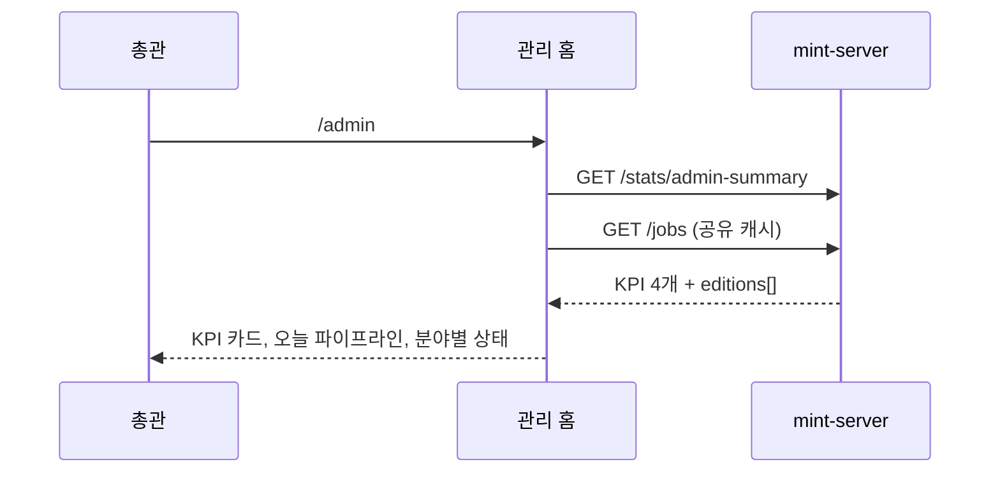
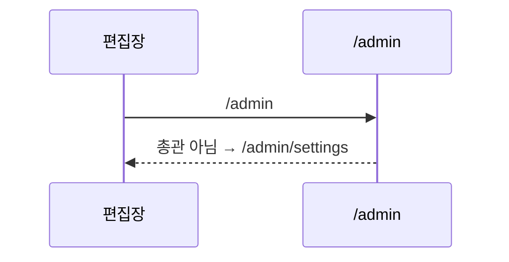

<!-- AI 지시문: 기능요청서 + 인터페이스 정의를 입력으로 작성하라. 3페이지 상한. 구현 코드를 쓰지 말고 구현이 따라갈 결정만 써라. 이 문서가 바이브코딩의 입력이다. -->
# 기술스펙_관리홈화면

- 기능요청: [mint-web#96](https://github.com/MEV-SW/mint-web/issues/96) — 관리자 리뉴얼 1차 FE-D
- 인터페이스 정의: 화면은 Figma R5 페이지의 R5-1 관리 홈·R5-13과 핸드오프 문서 §3 "01 관리 홈"이 겸함. 데이터는 [mint-server API스펙_관리요약집계](https://github.com/MEV-SW/mint-server/blob/main/docs/기능/174-관리요약집계/API스펙_관리요약집계.md)(`GET /api/v1/stats/admin-summary`).
- 선행: [#93](https://github.com/MEV-SW/mint-web/issues/93) 사이드바, [mint-server#174](https://github.com/MEV-SW/mint-server/issues/174) 배포
- 작성: 채윤성 (`yschae0311`) / 승인: 리뷰 없음 (MEV 기술스펙 규칙)
- 단계 구분: 05 탐문 후보 보드(`/admin/discovery`)는 PM이 승인한 단계 분할(2026-10-19)에서 2차다. 이 카드는 05로 가는 링크·뱃지를 2차에 넘기고, 1차 동안 탐문 후보 KPI는 지금의 탐문 게시판으로 연결한다(#93 문서와 같은 기준).

## 변경 범위
- `src/api/statsApi.ts`: `getAdminSummary()`와 응답 타입(`AdminSummary`, `AdminSummaryEdition`) 추가. `pending_users`·`open_inquiries`는 `number | null`.
- `src/hooks/useAdminSummaryQuery.ts` (신규): 쿼리 키 `['admin-summary']`, 총관이거나 편집장일 때만 활성(`canEditAny`), 60초마다 갱신, 창 포커스 갱신 없음(앱 기본값과 같음).
- `src/pages/AdminHomePage.tsx` (신규), 라우트 `/admin` 인덱스(총관 전용). 총관이 아니면 지금처럼 `/admin/settings`로 보낸다. 사이드바 01 "관리 홈"(운영 그룹, 총관만 노출, 뱃지 = 승인 대기 + 미답변 문의 = TopNav `adminBadgeTotal`과 같은 값).
- 화면 구성(R5-1):
  - KPI 카드 4개: 승인 대기(→ 08 계정 승인 대기 탭이 생기기 전까지 08 계정), 미답변 문의(→ 09), 수집 실패 소스(→ 04, 실패 필터는 2차 소스 카드 전까지 소스 화면으로만 이동), 탐문 후보(→ 지금의 탐문 게시판 `/discovery` 경로; 2차에서 05로 바뀜). 숫자는 관리 요약 API, 0이면 "0"을 회색으로 보인다(카드에서는 숨기지 않음).
  - 오늘 파이프라인: 기존 `useJobsQuery`로 진행 중 작업 진행률 또는 마지막 작업 상태·시각, 02 작업 로그 링크.
  - 분야별 상태 표: `editions[]` — 분야명, 소스 수, 실패 소스 수(1 이상이면 red), 탐문 후보 수.
- 사이드바 뱃지 연결(#93에서 미룬 것): 04 소스 = `failed_sources`(red), 05 탐문 후보 = `pending_candidates`(amber, 05 항목이 생기는 2차에서 표시). 편집장에게는 API가 담당 분야 범위로 준 숫자를 그대로 쓴다. 01·08·09 뱃지는 지금처럼 기존 쿼리(`['users']`, `['inquiries-open-count']`)를 쓴다 — 관리 요약 API의 `pending_users`·`open_inquiries`는 관리 홈 카드에만 쓰고, 두 출처가 갈라지지 않게 실행·승인 후에는 두 쿼리 키를 함께 무효화한다.
- 공통 상태(R5-13): 로딩 KPI 스켈레톤, 로드 실패 배너 + 다시 시도, 관리 요약 API가 403이면(편집장 권한 회수 등) 카드 영역을 숨기고 안내 한 줄.

## DB 스키마 변경분
- 없음 (프론트엔드).

## 핵심 흐름 (시퀀스 1-2개)

## 외부 의존성
- mint-server#174(`/stats/admin-summary`) 배포. 프론트가 먼저 배포되면 관리 홈 카드가 로드 실패 배너를 보이고 사이드바 04 뱃지가 비어 있다(다른 기능 영향 없음). 그래서 백엔드 먼저 배포한다.

## flag
- 없음.

## 테스트
- `npm run build`·변경 파일 `eslint`.
- 브라우저(개발 서버, 관리 요약·작업 API 응답 고정): 총관 KPI·분야 표·링크, 0 표시, 실패 1 이상 red, 로딩·실패 배너, 편집장이 `/admin` 접근 시 `/admin/settings`로 이동, 사이드바 04 뱃지가 `failed_sources`와 같음, 375px 카드 1열.
